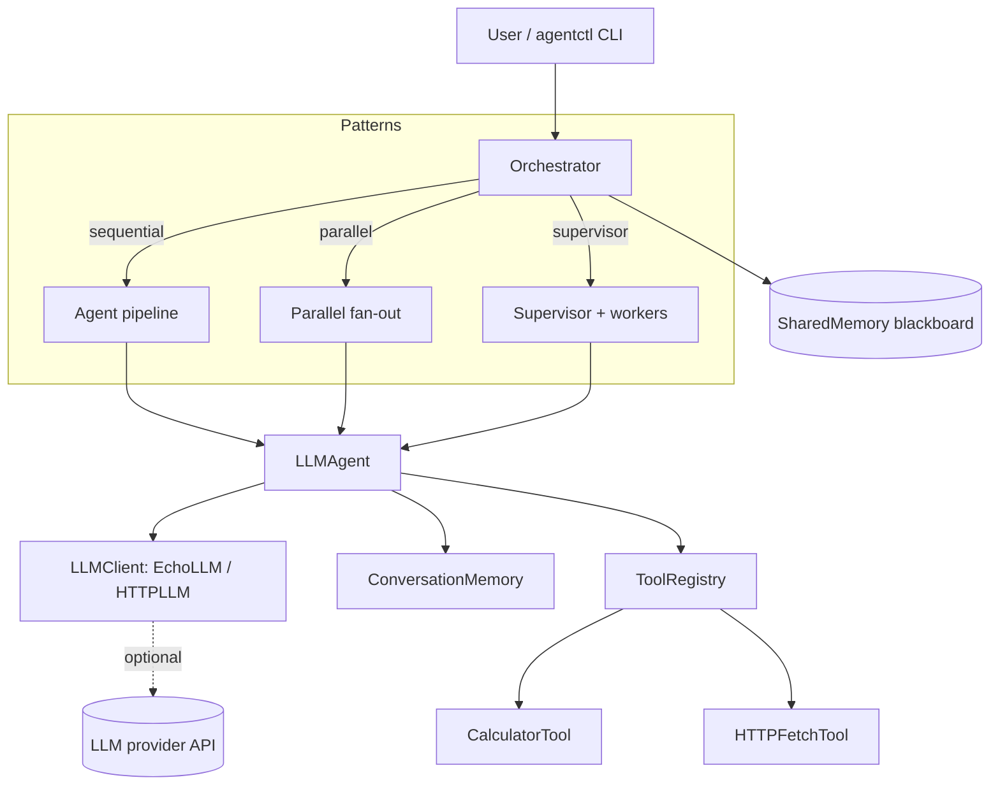

# multi-agent-ai-framework

A lightweight Python framework for building multi-agent AI systems: agent base
classes, orchestration patterns, tools, and memory.

[](LICENSE)
[](https://github.com/abhisheksawant52/multi-agent-ai-framework/actions/workflows/ci.yml)
[](https://www.python.org/)
[](https://github.com/psf/black)

## Overview

`multi_agent` gives you the building blocks to compose several AI agents into a
coordinated system without pulling in a heavy runtime. Each agent wraps an LLM
client, optional tools, and its own conversation memory; an orchestrator then
coordinates a group of agents using a chosen collaboration pattern.

The framework is deliberately provider-agnostic. The default `EchoLLM` runs
fully offline so you can build, test, and demo pipelines with no API keys or
network access, then swap in the `httpx`-based `HTTPLLM` (or your own
`LLMClient`) to talk to a real OpenAI-compatible endpoint.

It is intended for engineers prototyping agentic workflows — research/writer
pipelines, supervisor-worker delegation, fan-out/parallel processing — who want
a small, typed, well-structured base to extend rather than a monolithic
platform.

## Architecture



**Components**

- **Orchestrator** — runs agents in `sequential`, `parallel`, or `supervisor`
  mode over a shared blackboard.
- **LLMAgent** — an agent backed by an `LLMClient`, with memory and tools.
- **ToolRegistry** — name-indexed tools an agent can dispatch to.
- **Memory** — per-conversation history plus a thread-safe shared store.
- **LLMClient** — offline `EchoLLM` and HTTP `HTTPLLM` implementations.

## Features

- Abstract `Agent` base class with a concrete `LLMAgent` (`run` / `step`).
- Three orchestration patterns: sequential pipeline, parallel fan-out, and
  supervisor delegation.
- Pluggable tools via a `Tool` base class and `ToolRegistry`, with safe
  `CalculatorTool` and `HTTPFetchTool` references.
- Conversation and shared-memory abstractions.
- Provider-agnostic LLM layer; offline by default, HTTP-ready.
- Typed public API (`py.typed`), docstrings throughout.
- `agentctl` CLI for quick experimentation.
- Terraform module (ECR + SQS task queue) and a non-root Docker image.

## Tech Stack

- **Language:** Python 3.11 / 3.12
- **Core libs:** pydantic, pydantic-settings, httpx, click
- **Tooling:** ruff, black, pytest, pre-commit
- **Infra:** Terraform (AWS ECR + SQS), Docker
- **CI:** GitHub Actions (lint, test matrix, docker build, terraform validate)

## Getting Started

### Prerequisites

- Python 3.11 or 3.12
- (Optional) Docker and Terraform for the infrastructure assets

### Install

```bash
make install          # pip install -e ".[dev]"
```

### Configure

Copy the example environment file and adjust as needed. Every variable is
optional; the defaults run fully offline with `EchoLLM`.

```bash
cp .env.example .env
```

### Run

```bash
make example          # run the two-agent orchestration example
agentctl tools        # list registered tools
agentctl run "Explain multi-agent systems" --pattern sequential
```

### Test & lint

```bash
make test             # pytest
make lint             # ruff + black --check
```

## Project Structure

```text
.
├── src/multi_agent/         # library package
│   ├── __init__.py          # public API exports
│   ├── agent.py             # Agent ABC + LLMAgent
│   ├── orchestrator.py      # Orchestrator + Pattern
│   ├── tools.py             # Tool, ToolRegistry, reference tools
│   ├── memory.py            # ConversationMemory, SharedMemory
│   ├── message.py           # Message, Role
│   ├── llm.py               # LLMClient, EchoLLM, HTTPLLM
│   ├── config.py            # pydantic-settings configuration
│   ├── logging_config.py    # logging setup
│   └── cli.py               # agentctl entry point
├── examples/
│   └── two_agent_pipeline.py
├── tests/                   # pytest suite (offline)
├── terraform/               # ECR + SQS task queue module
│   ├── modules/agent_queue/
│   └── environments/{dev,prod}/
├── docs/architecture.md
├── Dockerfile
└── pyproject.toml
```

## Configuration

All settings are read from the environment with the `AGENT_` prefix (see
`.env.example`).

| Variable                         | Default       | Description                                  |
| -------------------------------- | ------------- | -------------------------------------------- |
| `AGENT_LLM_PROVIDER`             | `echo`        | `echo` (offline) or an HTTP provider         |
| `AGENT_LLM_MODEL`                | `gpt-4o-mini` | Model name passed to the client              |
| `AGENT_LLM_API_KEY`              | _unset_       | Provider API key (never commit real values)  |
| `AGENT_LLM_BASE_URL`             | _unset_       | Base URL for an OpenAI-compatible endpoint    |
| `AGENT_REQUEST_TIMEOUT_SECONDS`  | `30`          | Per-request timeout                           |
| `AGENT_MAX_STEPS`                | `8`           | Safety cap on steps per agent run             |
| `AGENT_LOG_LEVEL`                | `INFO`        | Root log level                                |
| `AGENT_LOG_JSON`                 | `false`       | Emit structured JSON logs                     |

## Deployment

A multi-stage, non-root `Dockerfile` builds a minimal image that runs the
example agent worker:

```bash
make docker
docker run --rm multi-agent-ai-framework:local
```

The `terraform/` module provisions the supporting AWS infrastructure — an ECR
repository for the worker image and an SQS task queue with a dead-letter queue:

```bash
cd terraform
terraform init -backend-config=environments/dev/backend.hcl
terraform plan -var-file=environments/dev/terraform.tfvars
```

Use the `environments/prod/` files for the production workspace. State backends
are configured via partial backend config (`backend.hcl`).

## Contributing

Contributions are welcome. Please read [CONTRIBUTING.md](CONTRIBUTING.md) and
our [Code of Conduct](CODE_OF_CONDUCT.md) before opening a pull request.

## Security

Please report vulnerabilities as described in [SECURITY.md](SECURITY.md).

## License

Distributed under the MIT License. See [LICENSE](LICENSE) for details.
